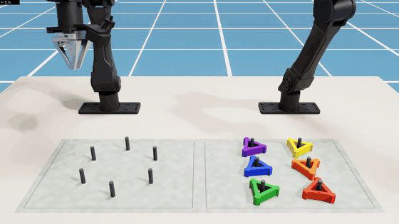
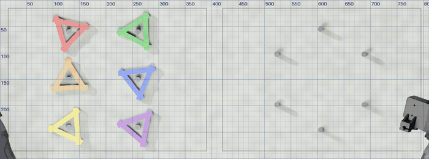
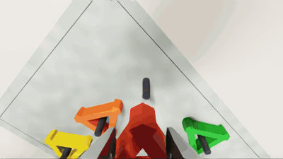
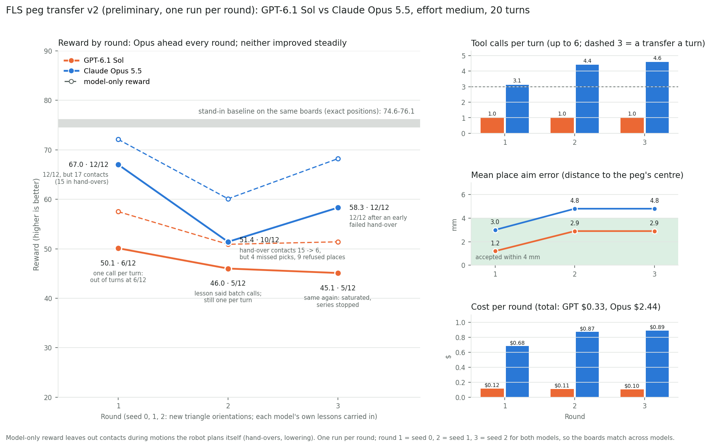
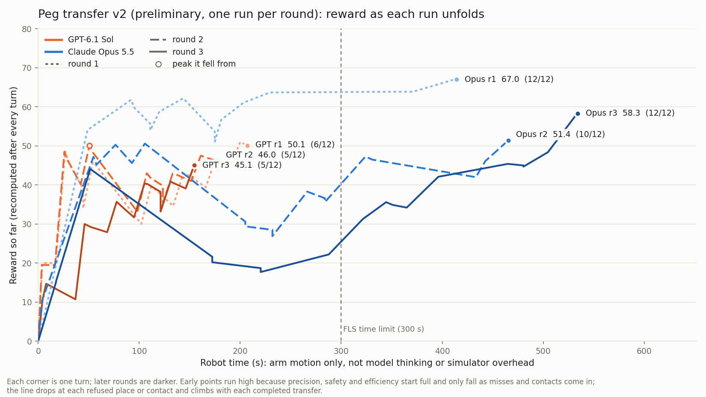
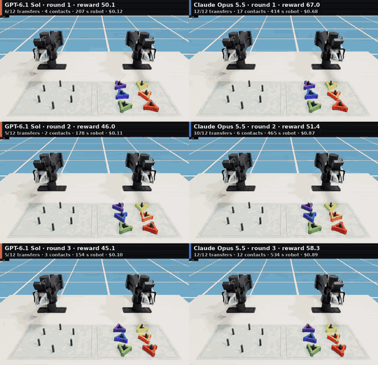

# 
FLS Peg Transfer

> **Preliminary results.** This is an early comparison: two models, three rounds each, one run per round. The main
> differences between the models were consistent, but whether the models learn across rounds is not yet settled.
> See [Limitations](#limitations).

## What?

Peg transfer is a foundational hand-eye coordination and bimanual dexterity exercise in the Fundamentals of
Laparoscopic Surgery (FLS) program. FLS certification is required for general surgeons before they perform a Minimally
Invasive Surgery (MIS). During the task, the trainee works with a laparoscopic box trainer, manipulation instruments and
camera view to:

1. Pick up a triangular object from a peg using the instrument.
2. Transfer it to the other instrument mid-air.
3. Place it over another peg on a different board.
4. Repeat this process for all the objects.

Conducted with 6 objects, it becomes a total of 12 object transfers (6 across, then 6 back) to be completed
successfully within 300 seconds. The test checks for hand-eye coordination which is crucial for surgeries.
Automated assessment of this task has already been studied on a physical box trainer, using three cameras and object
detection to time each transfer and flag drops [1]; we use the same task and the same kinds of measurements, but in
simulation and with an AI model, not a human, performing it.

We reproduce this task in simulation using NVIDIA Isaac Sim 6.0.1 with two YAM arms made by I2RT Robotics, with the aim of transferring
it to the real world. We compare two AI models, GPT-6.1 Sol (OpenAI) and Claude Opus 5.5 (Anthropic), both run at a
**medium thinking (reasoning effort) level**. Each turn the model is fed an overhead photo of the board with a
millimetre grid, the wrist-camera photos of its latest grasps, and a short report of what the previous actions did.
The model then decides and plans the next actions, whether to pick, hand over, or place an object, without receiving
any depth data or coordinates, reading positions entirely from the overhead photos. It may chain up to 6 actions in
one turn and has 20 turns in total to finish the task. A motion controller for the arms then executes the actions decided by the model and
checks for collisions.

 
<em>Figure 1. One full transfer by Claude Opus 5.5 in Isaac Sim, front camera (2x speed): the left arm picks the red
triangle, passes it to the right arm mid-air, and the right arm lowers it onto a peg.</em>

 
<em>Figure 2. What the model sees: the overhead photo with a millimetre grid at the start of each turn of one run,
first to last. Positions are read from these photos only.</em>

 
<em>Figure 3. The wrist-camera photos taken after each grasp in one run, which the model uses to check how the object
sits in the gripper.</em>

When an action misses, the report only says roughly which way and by how much, in words ("about a centimetre to the
left and a little lower in the photo"), never the exact position, the way a surgeon judges a miss by eye. After each
run (a "round"), the model reads a debrief of its own round and writes up to 10 lessons that are given to it in the
next round, so we can also see whether it learns from its own mistakes.

## Why?

The FLS peg transfer is a crucial hand-eye coordination test which the human surgeons must pass, therefore, we wish to
evaluate how robotic manipulators would perform on a real-world and recognized clinical skill if they are meant to aid
in Minimally Invasive Surgeries.

This task helps us recognize what the current limits of physical AI are and whether a general-purpose AI can perform
the hand-eye coordination at the same level as human surgeons just from visual feedback. Running these tests in
simulation first confirms the reproducibility and repeatability of results so that the results can be transferred to
the real world. By testing and comparing two models, we aim to generalize our results.

## How?

We evaluate each model by comparing it against a **stand-in (baseline)** and against each other. Each round uses a
slightly different board setup (the triangles sit on the pegs at different orientations), and round 1, 2 and 3 use the
same three setups for both models, so the two models face identical boards. All data is collected and evaluated
automatically against the simulator's ground truth.

### The stand-in baseline

The stand-in is a **scripted run**, not a model. Instead of reading the photo, it reads the exact position of every
object and peg from the simulator. Every turn it moves one object: it pinches the corner with the most room around the
fingers, hands the object over, and places it on the next free peg. It uses the same three actions, the same motion
controller, the same collision checks and the same scoring as the models; the only difference is who makes the
decisions and how they know where things are.

Why a scripted run is the right baseline here:

- **It separates the model from the robot.** The motion controller is ours and is not perfect: even with perfect
  information it makes some contacts during hand-overs and takes time. The stand-in shows exactly how well this robot
  can do when every decision is right, so any gap between a model and the stand-in is caused by the model's decisions
  (where it aims, which corner it picks, how it plans its turns), not by the robot.
- **It is a reference, not a strict ceiling.** With exact positions it never misses a pick or a placement, so it
  shows roughly the best this robot can do with simple, correct decisions. It is not optimal: it does one transfer
  per turn, does not try to be fast, and its hand-overs still cause contacts (a model can have fewer).
- **It is repeatable and free.** It gives the same result on the same board every time, costs nothing (no model
  calls), and was used to test the whole system before any paid runs.
- **A human baseline is not possible yet.** A surgeon cannot operate these simulated arms, and an FLS expert's
  numbers come from different instruments, so they cannot be compared directly.

We also ran a deliberately **"clumsy" scripted stand-in** (aim off by about 1 cm, wrong arm and bad corners some of
the time, correcting itself only from the vague feedback words) to check that the task can still be finished from the
same feedback the models get. With 45 turns it completed 11-12 of 12 transfers with no drops (it moves at most one
object per turn, so it needs more than the models' 20 turns).

### Definitions

| Action | Definition |
|---|---|
| Peg transfer | A successful peg transfer means that the object was picked up, passed mid-air and placed on a peg on the other board. |
| Drop | A drop means that the object didn't land on the peg it was supposed to: it touched the ground, went out of bounds, or was left resting on top of a peg. |
| Contact | A contact means that a simulated physical contact was made by two bodies (gripper, peg, board, object). Contacts less than 1.5 s apart count as one. |
| Robot time | The time the arms spend moving, in simulated seconds. It **does not include the model's thinking time**, the time waiting for the model's reply, or the simulator's own rendering time. This is the number compared with the FLS 300 s limit. |

Table 1. A list of actions and their evaluation definitions

Every failure during the experiment is labelled by cause and assigned as either the model's or the controller's. For
example, a contact during a pick (where the model chose the grip point) counts against the model; a contact during a
hand-over (a motion the robot plans by itself) counts against the controller. Each run also gets one reward score out
of 100 that combines completion, speed, precision, gentleness, safety and efficiency, plus a "model-only" reward that
leaves out the controller's contacts.

We ran 3 rounds per model. A series is stopped when its reward gains less than 3 points in two rounds in a row (which
can first happen after round 3), or after 5 rounds. This rule stopped GPT after round 3; Opus was still improving
(+6.9 from round 2 to 3) and was stopped at 3 rounds to match GPT and stay within its budget.

## Preliminary results

| | Stand-in (baseline) | GPT-6.1 Sol | Claude Opus 5.5 |
|---|---|---|---|
| Peg transfers | 12/12 every round | 6, 5, 5 of 12 (ran out of turns) | 12, 10, 12 of 12 |
| Drops | 0 | 0 | 0 |
| Grasps that worked | 36/36 | 18/19 | 34/41 |
| Placements accepted | 36/36 | 16/24 | 34/60 |
| Placement error (mean) | 0 mm | 1.2 - 2.9 mm | 3.0 - 4.8 mm |
| Contacts | 8, 11, 9 | 4, 2, 3 | 17, 6, 12 |
| Robot time | 377.5, 406.0, 379.2 s | 207.2, 177.9, 154.5 s (not finished) | 414.3, 465.3, 534.1 s |
| Actions per turn (mean) | 2.8 | 1.0 | 3.1 - 4.6 |
| Reward (out of 100) | 76.1, 74.6, 75.9 | 50.1, 46.0, 45.1 | 67.0, 51.4, 58.3 |
| Cost for 3 rounds | $0 | $0.33 | $2.44 |

Table 2. Preliminary results for rounds 1, 2 and 3 (one run each, on the same three boards for every column). Medium
thinking level for both models.

 
<em>Figure 4. Reward by round (solid) and model-only reward (dashed), actions per turn, mean placement error against
the 4 mm tolerance, and cost per round. The grey band is the stand-in baseline.</em>

 
<em>Figure 5. Each run's reward, recomputed after every turn, against robot time (thinking time not included). A line
drops at each missed placement or contact and climbs with each completed transfer. GPT's runs end early because it
ran out of turns; Opus's runs go past the 300 s line.</em>

 
<em>Figure 6. All six runs from the front camera at 12x speed, GPT-6.1 Sol on the left and Claude Opus 5.5 on the
right, rounds 1 to 3 from top to bottom.</em>

Note that even the stand-in takes 378-406 s of robot time, more than the FLS 300 s limit: our motion controller is
slower than a trained surgeon, so time should be compared with the stand-in rather than with 300 s for now.

## Inference (preliminary)

These findings come from one run per round. The first three held on every board; the ones about learning across
rounds are inconclusive (see Limitations).

- **Claude Opus 5.5 did better in every round, because of planning, not sight.** GPT-6.1 Sol reads positions more
  precisely (1.2 - 2.9 mm placement error against Opus's 3.0 - 4.8 mm), but it only ever made one action per turn, so it
  ran out of its 20 turns after 5-6 transfers. Opus chained the pick, hand-over and place of an object in one turn and
  finished all 12 transfers in two of its three rounds.
- **GPT wrote the right lesson but did not follow it.** After round 1 it wrote that it should do the pick, hand-over and
  place in one turn, yet rounds 2 and 3 still had one action per turn. Its reasoning shows it treats several actions in
  one reply as "parallel" and therefore unsafe, even though the instructions say they run in order.
- **Neither model improved steadily from its lessons.** Opus used some of them (hand-over contacts fell from 15 to 6
  after round 1; it corrected its pick aim after round 2), but the differences between boards and the controller's own
  hand-over failures changed the score more than the lessons did. GPT's series was stopped after round 3 because its
  score kept falling.
- **Both models are well below the stand-in** (best 67.0 against 74.6-76.1), mostly from missed placements, extra turns,
  and in Opus's case slow robot time.
- **Simulation problems we found and will fix next:** the feedback words ("about a centimetre") made both models
  overshoot a peg back and forth, a failed hand-over message wrongly said that retrying would not help, and the
  controller's hand-over retries cause most of the contacts.

## Limitations

- **Few runs.** Two models, three rounds each, and one run per round. Every round used a different board, so a change
  from one round to the next could come from the lessons, the board, or the robot's own hand-over luck; with one run
  each we cannot tell these apart. Claims about learning across rounds are therefore inconclusive.
- **What holds despite this:** GPT made one action per turn in every one of about 170 turns across six runs (v1 and
  v2); Opus completed more transfers than GPT on all three boards; GPT's placement error was lower in every round.
- **Score gaps are rough.** Rewards are single runs, not averages, so "about 10 points higher" is an estimate.
- **Series length.** GPT's series was stopped by the saturation rule; Opus's was stopped at three rounds to match GPT
  and stay within budget while its reward was still rising.
- **One setting per model.** Both models ran at medium thinking level with a 20-turn limit. The turn limit makes
  chaining actions matter a lot; other limits or thinking levels may change the ranking.
- **The robot is part of the result.** Our motion controller plans every hand-over and placement. Even the stand-in
  makes 8-11 contacts and needs 378-406 s of robot time, more than the FLS limit of 300 s, so time and contacts are
  limited by the controller, not only by the model.
- **No drops is partly by design.** A placement is refused unless it is within 4 mm of a peg, so the robot never lets
  go in the wrong place; FLS drops are not tested in the same way.
- **Simulation, scaled up.** The task is scaled to the YAM gripper (70 mm triangles, 810 x 300 mm board) and seen from
  an overhead camera with a millimetre grid, not a laparoscope. Results may not carry over to real instruments,
  real cameras or a real robot.
- **Feedback wording.** The vague feedback words ("about a centimetre" for 5-12 mm) made both models overshoot a peg;
  this affects both models but may cost turns.
- **Baseline.** The stand-in is a scripted reference with exact positions, not a human surgeon.
- **Point in time.** Model versions and prices are those of October 2026.

**Next steps** to make the learning results conclusive: repeat each round on the same board 3-5 times, and run each
model with and without lessons on the same set of boards.

## Use in the Medical Industry

This could pose as one of the reproducible and clinically recognized tests for evaluating AI models before they are
allowed to interact with any hardware or patients. This task could also be used to train models with routine tasks like
passing over equipment, paper towels, etc. and could be used as a safety evaluation to ensure minimum contacts when in
an interactable environment.

## Code

The code to run this experiment (v2) is in [`peg_transfer_benchmark/`](peg_transfer_benchmark/); see its
[README](peg_transfer_benchmark/README.md#run-it) for what is needed and how to run a round.

## Third-party software, robots and models

- **Robot arms:** YAM arms by I2RT Robotics. The robot model (URDF and meshes) comes from the
  [I2RT repository](https://github.com/i2rt-robotics/i2rt) under the MIT License; one file here,
  `peg_transfer_benchmark/core/yam_geometry.npz`, is measured from those meshes.
- **Simulator:** [NVIDIA Isaac Sim 6.0.1](https://developer.nvidia.com/isaac/sim) (source under Apache 2.0, with
  NVIDIA's Additional Software and Materials License for its Omniverse components). Not included here.
- **AI models:** GPT-6.1 Sol by OpenAI (OpenAI API) and Claude Opus 5.5 by Anthropic (through
  [OpenRouter](https://openrouter.ai)).
- **Libraries:** NumPy, SciPy, Pillow, matplotlib, imageio and imageio-ffmpeg (FFmpeg), and USD, which ships with
  Isaac Sim.
- **Code assistant:** Claude Code (Anthropic) helped write the code and documentation.
- **FLS** is a program of SAGES and the American College of Surgeons. This project is not affiliated with or endorsed
  by them, I2RT Robotics, NVIDIA, OpenAI or Anthropic.

Full notices, including I2RT's MIT License text: [THIRD_PARTY_NOTICES.md](THIRD_PARTY_NOTICES.md).

## References

[1] F. Rashidi Fathabadi, J. L. Grantner, S. A. Shebrain, and I. Abdel-Qader, "Autonomous sequential surgical skills
assessment for the peg transfer task in a laparoscopic box-trainer system with three cameras," *Robotica*, vol. 41,
no. 6, pp. 1837-1855, 2023. doi: [10.1017/S0263574723000218](https://doi.org/10.1017/S0263574723000218)

## Contributors

- Adyaa Khera
- Claude Code
